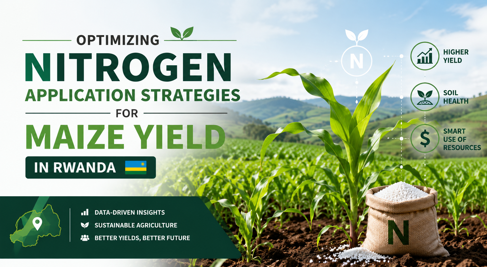
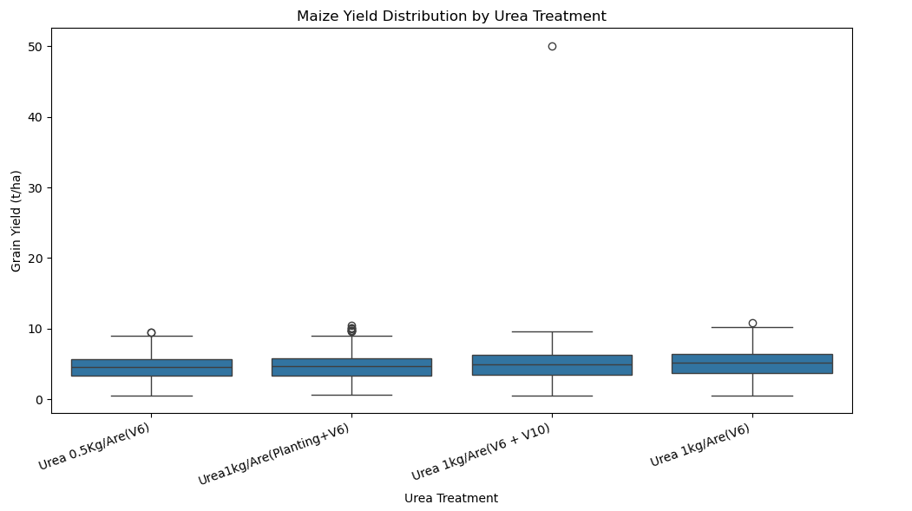
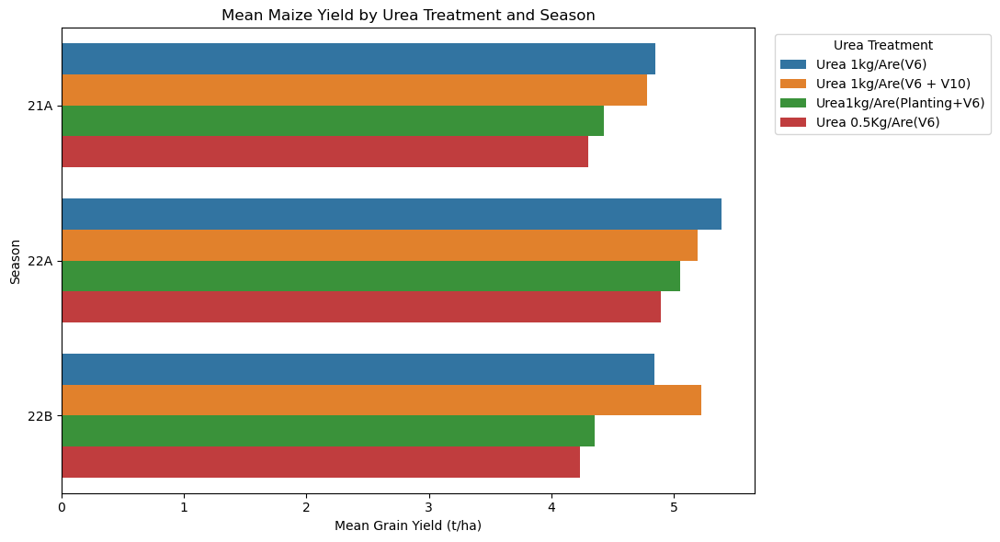
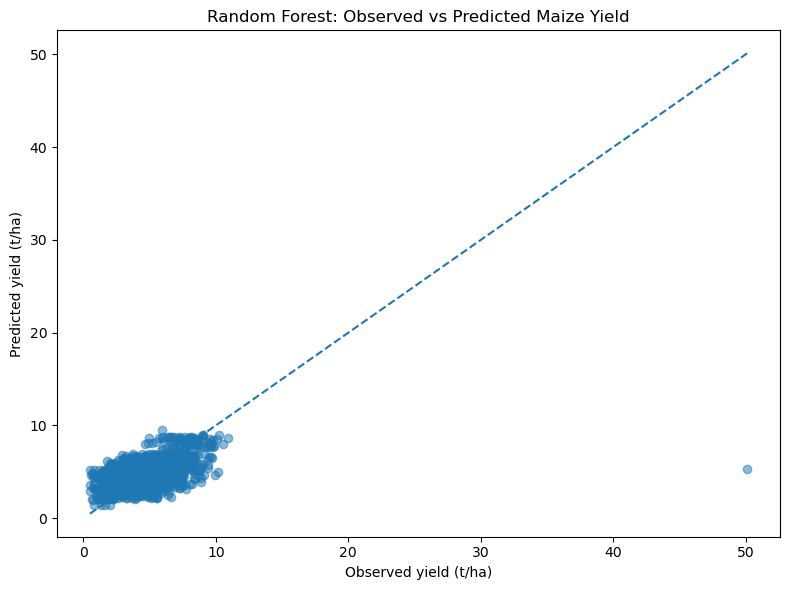
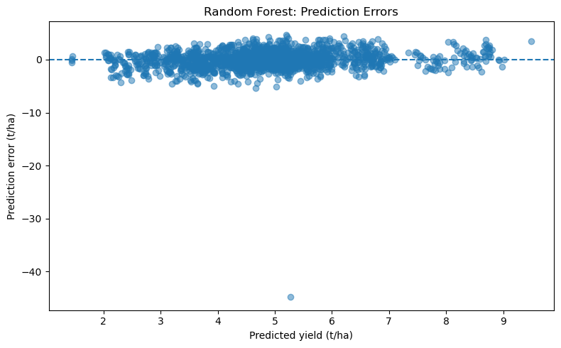

---

<h1 align = "center"> 
Rwanda Maize Fertilizer Trial: Yield Analysis & Decision Support
</h1>

<p align = "center">

</p>

---

<h4 align = "center"> 
Optimizing Nitrogen Application Strategies for Maize Yield in Rwanda
</h4> 

# Yield Analysis and Decision Support

## Repository Structure

```
rwanda-maize-urea-analysis/
│
├── 01_Data/
│   ├── raw/
│   ├── external/
│   └── processed/
│
├── 02_Notebooks/
│   ├── 01_data_audit.ipynb
│   ├── 02_data_preparation.ipynb
│   ├── 03_eda.ipynb
│   ├── 04_treatment_analysis.ipynb
│   ├── 05_yield_drivers.ipynb
│   ├── 06_yield_prediction.ipynb
│   └── 07_spatial_analysis.ipynb
│
├── 03_Scripts/
│
├── 04_Outputs/
│   ├── figures/
│   ├── tables/
│   └── models/
│
├── 05_Report/
│   └── Rwanda_Maize_Urea_Trial_Report.pdf
│
├── 06_Dashboard/
│   ├── images/
│   └── screenshots
│
└── README.md
```
## 1. Project Overview

Evergreen Institute is a non-profit research organization working with farmers across Africa to improve agricultural productivity and livelihoods.

This project analyzes a maize field trial conducted across three agricultural seasons and multiple mega-environments in Rwanda. The objective was to evaluate how Urea fertilizer rates and application timings relate to maize grain yield, identify factors associated with yield variation, and translate the findings into evidence-based guidance for agricultural extension teams.

**Primary research question:** How do Urea fertilizer rate and application timing affect maize yield across the environments represented in the trial?

## 2. The Trial

The analysis covers four Urea treatment combinations:

| Treatment | Urea rate | Application timing |
|---|---:|---|
| A | 50 kg/ha | All at V6 |
| B | 100 kg/ha | Planting + V6 |
| C | 100 kg/ha | V6 + V10 |
| D | 100 kg/ha | All at V6 |

The primary outcome was grain yield (`yield_tha`), measured in tonnes per hectare. The data included plot-level treatment and agronomic records, field-level environmental and geographic characteristics, and a separate plot-level soil dataset.

## 3. Analytical Workflow

The project followed an end-to-end analytical workflow:

1. **Data audit and preparation** — profiled the source tables, assessed data quality, standardized fields, parsed dates, and integrated plot, field, and available soil records.

2. **Exploratory analysis** — examined yield distributions and treatment performance across seasons and mega-environments.

3. **Statistical modeling** — used mixed-effects regression to estimate adjusted treatment differences and test whether treatment effects varied by season or mega-environment.

4. **Agronomic analysis** — examined associations between yield and selected crop-management variables.

5. **Predictive modeling** — compared a mean baseline, Ridge Regression, and Random Forest using grouped cross-validation.

6. **Advisory analysis** — translated the statistical evidence into provisional yield-oriented guidance and documented the limits of economic recommendations.

External soil and rainfall enrichment was not completed because the data retrieval attempts were unsuccessful. The analysis therefore relies on the supplied datasets.

## 4. Key Findings

### Fertilizer treatment performance

The mixed-effects model estimated the following adjusted mean yields:

| Treatment | Adjusted mean yield |
|---|---:|
| 50 kg/ha, all at V6 | 4.571 t/ha |
| 100 kg/ha, planting + V6 | 4.715 t/ha |
| 100 kg/ha, all at V6 | **5.117 t/ha** |
| 100 kg/ha, V6 + V10 | 5.071 t/ha |

Applying 100 kg/ha entirely at V6 produced the highest adjusted mean yield. Splitting the same rate between V6 and V10 produced a statistically comparable yield.

Both strategies significantly outperformed the 50 kg/ha treatment after Holm adjustment for multiple comparisons. The planting–V6 split did not show a statistically significant yield advantage over the 50 kg/ha treatment.

No statistically significant treatment-by-mega-environment or treatment-by-season interactions were detected at the 5% level. The results therefore do not establish a need for different treatment recommendations by environment or season.

### Yield prediction

Random Forest performed best among the three evaluated models under grouped cross-validation.

| Model | MAE (t/ha) | RMSE (t/ha) | R² |
|---|---:|---:|---:|
| Random Forest | 1.285 | 1.941 | 0.206 |
| Ridge Regression | 1.298 | 1.965 | 0.186 |
| Mean baseline | 1.532 | 2.182 | -0.004 |

A sensitivity analysis excluding one extreme yield observation of 50.1 t/ha improved the Random Forest's MAE to 1.216 t/ha, RMSE to 1.533 t/ha, and R² to 0.321. The observation was retained in the primary dataset because its validity was not disproved.

The model captures useful yield patterns, but its predictive performance is moderate. It should not be treated as a validated forecasting system for new locations.

## 5. Figures and Visualizations

The following figures can be added to illustrate the analysis.

### Yield distribution by treatment





### Predictive model performance





## 6. Advisory Implications and Limitations

These results identify applying 100 kg/ha of Urea entirely at V6 as the leading yield-oriented option in this trial, with splitting the same rate between V6 and V10 as a statistically comparable alternative.

Other limitations include incomplete soil coverage, unmatched field and plot records, incomplete experimental units, missing application dates, and the absence of successfully integrated external rainfall and soil estimates.

### **Final advisory conclusions**

For Evergreen Institute, our findings can be summarized follows:

|Finding	|Evidence	|Implication for advisory decisions|
|----|----|----|
|Applying 100 kg/ha entirely at V6 produced the highest adjusted mean yield.	|5.117 t/ha	|Leading candidate when the objective is to maximize yield.|
|Splitting 100 kg/ha between V6 and V10 produced a comparable yield.	|5.071 t/ha; adjusted pairwise p = 0.6532	|A reasonable alternative for further consideration.|
|Both treatments outperformed the 50 kg/ha treatment in adjusted yield.	|Yield advantages of 0.546 and 0.500 t/ha, respectively; both statistically significant after Holm correction	|The trial supports a yield advantage from these full-rate strategies under the conditions studied.|
|Splitting 100 kg/ha between planting and V6 performed less well than the other full-rate strategies.	|Adjusted mean of 4.715 t/ha	|Less promising when the sole objective is yield.|
|No statistically significant treatment interactions with mega-environment or season were detected.	|Interaction p-values of 0.424 and 0.103	|The available evidence does not justify separate treatment recommendations by mega-environment or season.|

## 7. Tools and Methods

- **Python:** data preparation and analysis
- **Pandas and NumPy:** data manipulation
- **Matplotlib and Seaborn:** exploratory visualizations
- **Statsmodels:** mixed-effects regression
- **Scikit-learn:** predictive modeling and grouped cross-validation
- **Folium:** interactive field mapping workflow

## 8. Project Outcome

This project demonstrates an end-to-end agricultural data-analysis workflow, from data-quality assessment and integration through statistical inference, predictive modeling, and practical interpretation.

Its central contribution is not simply identifying the treatment with the highest observed yield, but evaluating treatment differences statistically, testing their consistency across environments and seasons, assessing prediction quality, and communicating the limits of the available evidence.

