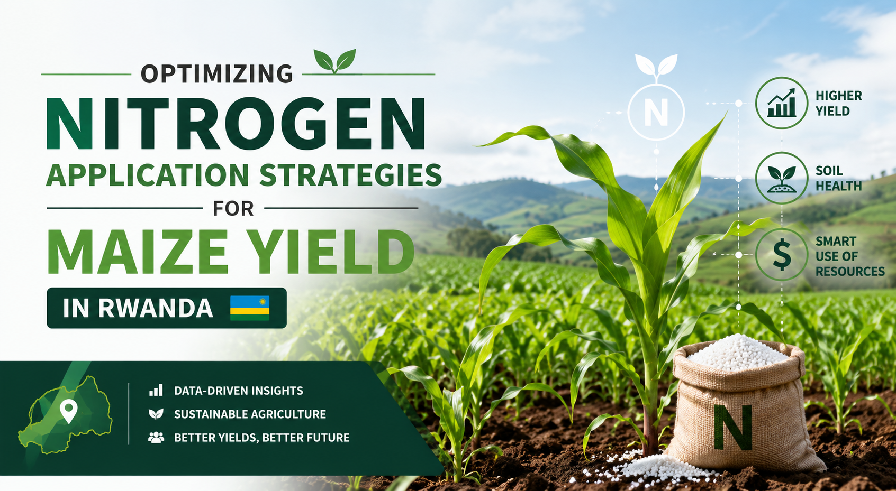
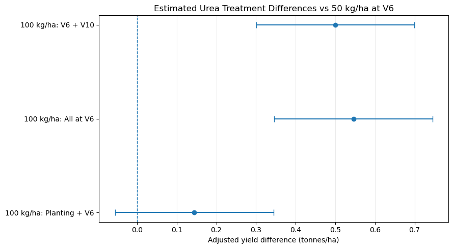
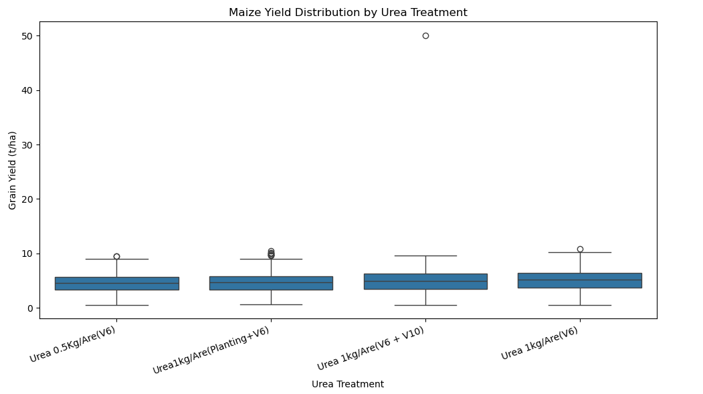
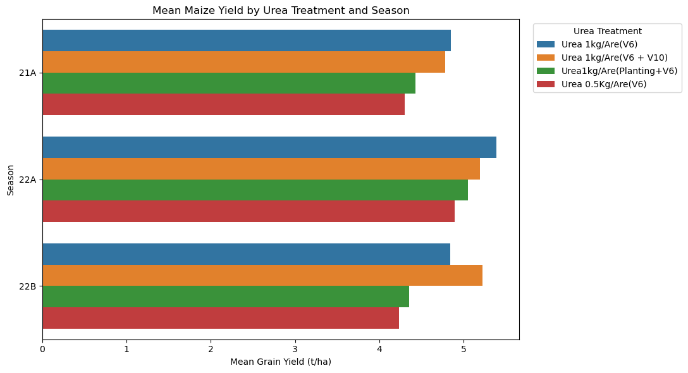
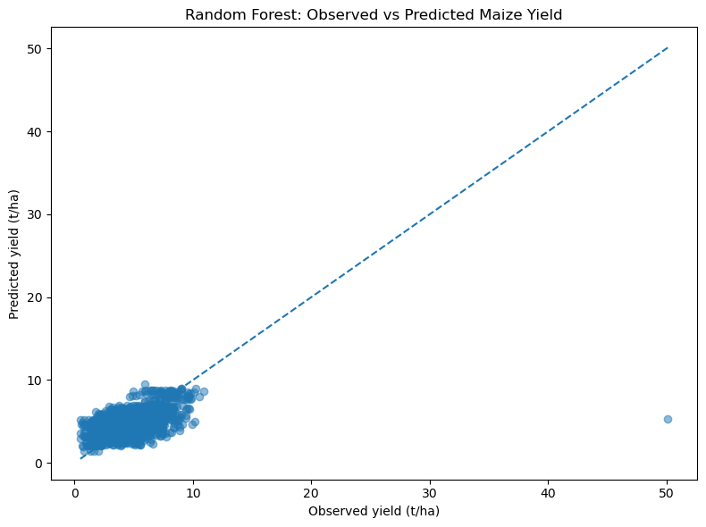
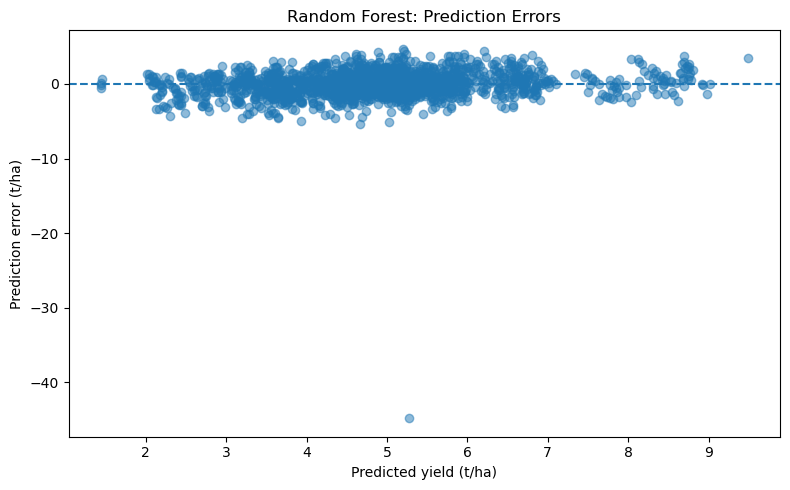

<p align="center">
  
</p>

<h1 align="center">Which fertilizer strategy actually raises maize yield?</h1>

<p align="center">
  <b>Field-trial analysis and decision support for an agricultural NGO in Rwanda</b><br>
  Python · Mixed-effects models · Random Forest · Grouped cross-validation
</p>

<p align="center">
  
  
  
  
</p>

---

## At a glance

| | |
|---|---|
| **Client question** | Which of four Urea rate-and-timing strategies should extension officers recommend to farmers? |
| **Data** | 1,598 trial plots · 401 fields · 3 seasons (21A, 22A, 22B) · 4 mega-environments · plot, field and soil tables |
| **Answer** | Apply **100 kg/ha of Urea all at the V6 stage**: **+0.55 t/ha (≈ +12%)** over the 50 kg/ha practice, statistically significant |
| **Also good** | Splitting 100 kg/ha between V6 and V10 gives a statistically equivalent yield (p = 0.65) |
| **Not supported** | Splitting between planting and V6 showed no significant gain over 50 kg/ha |
| **Deliverables** | Audited & cleaned dataset with decision log · treatment-effect model · yield-prediction model · advisory summary & slide deck |

---

## The key result

<p align="center">
  
</p>

Each point is the yield gain over the 50 kg/ha baseline after adjusting for season, environment and field-to-field variation; the bars are 95% confidence intervals. Two strategies clear zero comfortably, and one does not.

| Treatment | Adjusted mean yield | Gain vs. 50 kg/ha | Significant? (Holm-adjusted) |
|---|---:|---:|:---:|
| 50 kg/ha, all at V6 (baseline) | 4.57 t/ha | n/a | n/a |
| 100 kg/ha, planting + V6 | 4.72 t/ha | +0.14 t/ha | No |
| 100 kg/ha, V6 + V10 | 5.07 t/ha | +0.50 t/ha | Yes |
| **100 kg/ha, all at V6** | **5.12 t/ha** | **+0.55 t/ha** | **Yes** |

**One recommendation everywhere.** Treatment effects did not differ significantly by mega-environment (p = 0.42) or season (p = 0.10), so the evidence doesn't justify separate rules for each region.

---

## What I did

1. **Audited the data.** Profiled three source tables and found unmatched field records, incomplete experimental units, season-specific missingness and an extreme 50.1 t/ha yield. Every issue went into a written decision log.
2. **Cleaned without losing information.** Kept the raw data untouched, parsed dates, added quality flags and merged the tables. All 1,598 plots were kept and none were deleted silently.
3. **Explored.** Compared yield distributions by treatment, season and environment.
4. **Estimated treatment effects properly.** Plots in the same field share conditions, so I used a **linear mixed-effects model** with field as a random effect. I added Holm-corrected pairwise tests, likelihood-ratio tests for interactions, and an outlier sensitivity check.
5. **Built a yield-prediction model.** Compared a baseline, Ridge and Random Forest using **grouped cross-validation** (whole fields held out) to mimic predicting for a new farm before planting.
6. **Turned the results into advice.** Wrote yield-focused guidance for extension teams, including where the evidence stops.

## About the limits

- **Prediction is moderate.** The Random Forest beats the baseline (MAE 1.29 vs 1.53 t/ha) but explains about 21% of the variance (32% without the extreme plot). It's a useful signal but not a forecasting tool for new locations.
- **Soil coverage is partial.** Fewer than half the plots (736 of 1,598) had soil records, and the external SoilGrids/rainfall enrichment failed because the service timed out. The attempt is documented in notebook 05.
- **There's no economic analysis.** The recommendation is about yield only. Fertilizer and grain prices are needed before giving profitability advice.

<details>
<summary><b>Model comparison and diagnostic plots</b></summary>

| Model | MAE (t/ha) | RMSE (t/ha) | R² |
|---|---:|---:|---:|
| Random Forest | 1.285 | 1.941 | 0.206 |
| Ridge Regression | 1.298 | 1.965 | 0.186 |
| Mean baseline | 1.532 | 2.182 | -0.004 |

<table>
  <tr>
    <td width="50%"><br><sub>Yield distribution by treatment</sub></td>
    <td width="50%"><br><sub>Yield by treatment and season</sub></td>
  </tr>
  <tr>
    <td width="50%"><br><sub>Observed vs. predicted yield</sub></td>
    <td width="50%"><br><sub>Prediction errors</sub></td>
  </tr>
</table>
</details>

---

## Explore the work

| Notebook | What's inside |
|---|---|
| [01 Data audit](02_Notebooks/01_data_audit.ipynb) | Structure, keys, missingness, experimental-design checks |
| [02 Cleaning & integration](02_Notebooks/02_data_cleaning_&_integration.ipynb) | Traceable cleaning, merge validation, decision log |
| [03 EDA](02_Notebooks/03_exploratory_data_analysis.ipynb) | Yield by treatment, season, mega-environment |
| [04 Treatment effects](02_Notebooks/04_treatment_effect_analysis.ipynb) | **Mixed-effects model, pairwise tests, sensitivity analysis** |
| [05 Data enrichment](02_Notebooks/05_data_enrichment.ipynb) | External soil data attempt (SoilGrids) |
| [06 Yield prediction](02_Notebooks/06_yield_prediction.ipynb) | Ridge vs Random Forest, grouped CV, error analysis |
| [07 Fertilizer advisory](02_Notebooks/07_fertilizer_advisory.ipynb) | **Final recommendations for extension teams** |

📊 Summary deck: [`03_Report/reports/Report Summary.pptx`](03_Report/reports/Report%20Summary.pptx) · 📘 Data dictionary: [`01_Data/codebook/Codebook.xlsx`](01_Data/codebook/Codebook.xlsx)

<details>
<summary><b>Run it yourself</b></summary>

```bash
git clone https://github.com/Vin-Okumu/maize-yield-optimization-rwanda.git
cd maize-yield-optimization-rwanda
conda env create -f environment.yml
conda activate maize-yield
jupyter lab
```
Run the notebooks in order (01 → 07). Raw data is in `01_Data/raw/`, and the cleaned outputs are in `01_Data/processed/`.
</details>

<details>
<summary><b>Repository structure</b></summary>

```
maize-yield-optimization-rwanda/
├── 01_Data/        raw/ · processed/ · codebook/
├── 02_Notebooks/   01–07 analysis pipeline
├── 03_Report/      figures/ · reports/ (summary deck)
├── 04_Images/      banners and thumbnails
└── environment.yml
```
</details>

---

## Need something similar?

I help clients, organizations, NGOs and researchers turn messy field-trial and survey data into clear, defensible decisions. 

My analyses cover experimental analysis, mixed models, predictive modelling and reports that non-technical teams can act on.

Have a similar project on your hands? Invite to work on [Upwork](https://www.upwork.com/freelancers/uv23o9) · Reach out via [LinkedIn](https://www.linkedin.com/in/vince-okumu23/) · Or email me at vinny.otieno23@gmail.com

**Vincent Okumu**
